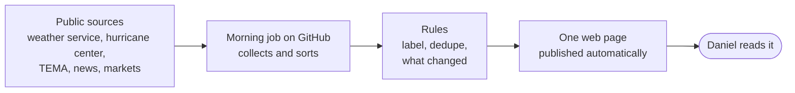

# News Desk: one page

**What it is.** A single web page, https://torelldan.github.io/news-desk/, that tells Daniel each morning whether anything today matters for a household in **Thompson's Station, TN 37179**, and what, if anything, to do about it. Most days the honest answer is "nothing needs an action", and the page says so.

## Why it exists

News is loud and repetitive. The desk turns dozens of official feeds and headlines into a short, calm situation report:

- **Is anything dangerous coming here?** Tornado and severe-storm watches, hurricane tracks toward Tennessee, local weather alerts, TEMA notices that name Williamson County, power outages, road closures.
- **What's happening in the world that I should keep an eye on?** Current wars, U.S. government, major quakes, outbreaks, asteroids, each with a plain verdict.
- **What changed since yesterday?** Only real changes, not the same story re-run by ten outlets.
- **Context.** Markets, gold and silver, crypto, science headlines, followed podcasts and accounts.

## How it decides what matters

Every item gets one of four labels:

| STANDBY | ALERT | ACTION | CRITICAL |
|---|---|---|---|
| On file. Nothing to do. | Worth watching. Read the source. | Prepare something specific. | Act now (for example: tornado warning here, take shelter). |

CRITICAL is rare on purpose: a distant quake or a routine asteroid flyby is not an emergency. An ALERT older than three days drops back to STANDBY. A short **"so what"** line appears only when there is something to do. A hard threshold (a magnitude 7+ quake, a Tennessee tornado warning, a storm heading for the Gulf) raises the label and shows a four-item checklist: **fuel, water, cash, meds**.

When many outlets carry one story, the desk shows it **once** with "+N related". It lists the story again only if the facts change (a new claim, or a higher label).

## How it works

- **Automatic, free, and simple.** GitHub runs a collection job each morning (eight tries between about 3 and 11 AM CT, since GitHub's timer runs late). It builds one self-contained page and publishes it. There is no server, no database, and no paid monitoring.
- **Honest about gaps.** If a source doesn't answer, the page says **"Source down"** and keeps the last good data. It never shows a fake all-clear or invents a number.
- **Readable at a glance.** Black-and-green "Matrix" style. Every section starts folded to one line: label, count, top headline. Click to open.
- **Fixed facts where a feed isn't needed.** For example, a card explains that the "Nov 17 global blackout" is a rumor and the real event is a one-minute national alert test. That card removes itself after Nov 18.

## What Daniel does

- **Read it.** Start with *Standing orders* (things to act on) and *Storm watch*.
- **Refresh it** if it looks stale: click **Refresh**, then **Run workflow** on the GitHub page. It's live again in about 3–5 minutes.
- **Approve changes**: open the link you're sent, click the green **Merge pull request**, then **Confirm merge**.

## Limits to know

GitHub's morning timer is unreliable, so a fresh desk sometimes needs a manual refresh. Four world sources (GDACS, ReliefWeb, WHO, CDC HAN) are currently down, and Tennessee's TEMA site answers only some of the time. The desk is informational. It is not trading advice or an emergency alert system: for a real warning, follow official alerts.

*More detail: [KDD.md](KDD.md) (rules and sources) · [PFL.md](PFL.md) (how it runs).*
