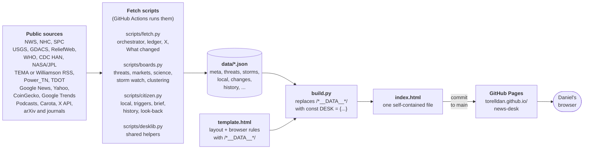
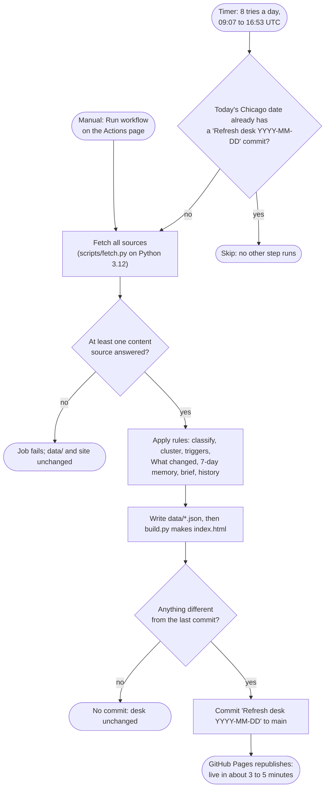
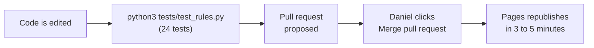
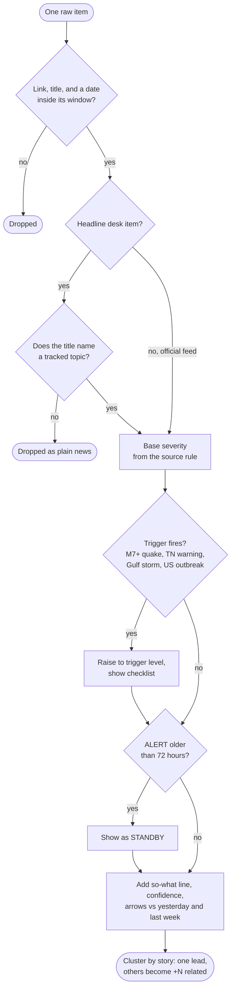
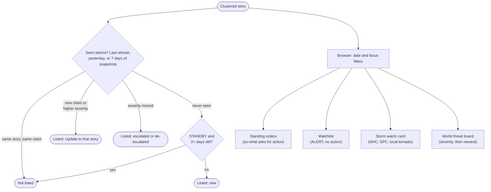
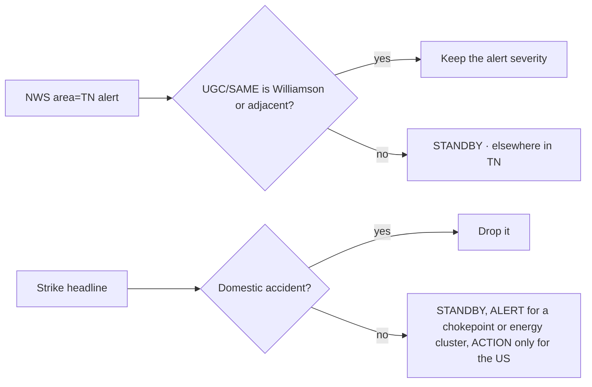
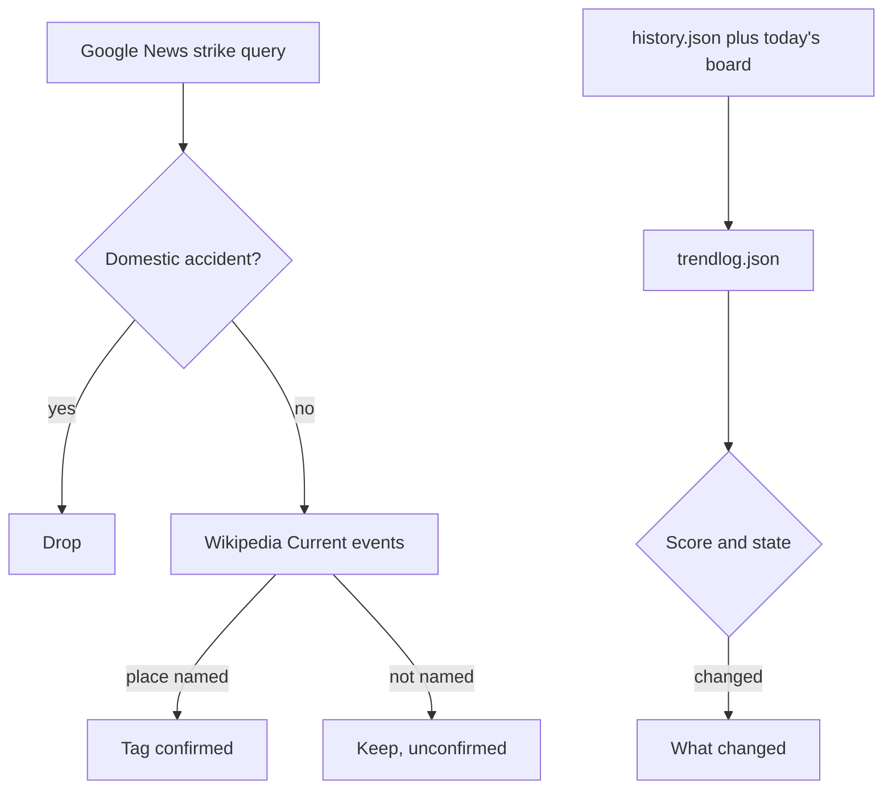

# News Desk: Process Flow Layout (PFL), with embedded architecture

| | |
|---|---|
| **Repository** | https://github.com/torelldan/news-desk |
| **Live site** | https://torelldan.github.io/news-desk/ |
| **Written against** | `main` at commit `c175c1d` (after PR #17, merged Nov 11, 2026, 1:20 PM CT) |
| **Companion docs** | [KDD.md](KDD.md) (rules, sources, severities), [ONE-PAGER.md](ONE-PAGER.md) |

This document shows **how the desk runs**: the parts it is made of, the order things happen in on a refresh, and how one news item is classified. Each diagram has a step table: what goes in, what comes out, and what happens when a step fails. The last section is a plain-language operations guide.

---

## 1. Architecture

### 1.1 Diagram A: from sources to the published page



### 1.2 Components

| Component | Role | Inputs | Outputs | If it fails |
|---|---|---|---|---|
| **Public sources** | Raw facts: alerts, headlines, prices, posts | — | RSS, JSON, GeoJSON, HTML | That source is marked "Source down"; the rest continue |
| **`scripts/fetch.py`** | Runs everything in order; the ledger (podcasts, Carota, X); What changed; writes most JSON | `scripts/sources.json`, the previous `data/*.json`, `X_BEARER_TOKEN` | `data/*.json` | Exit code 1 only if *every* content fetch failed; then `data/` is left untouched |
| **`scripts/boards.py`** | Markets, threat board, assets, science, Storm watch, story matching and clustering | public feeds | `markets`, `threats`, `assets`, `science`, `storms` JSON | Each board keeps its previous file (`refresh_file`) and logs the error |
| **`scripts/citizen.py`** | Prepared-citizen layer: local 37179, triggers, outlook arrows, so-what lines, trends, radar, impact, brief, history, look-back | threat items, assets, trends, history | `local`, `triggers`, `trends`, `radar`, `impact`, `history`, `lookback` JSON, the brief | Each part has its own try/except and writes an `n/a` row or a gap |
| **`scripts/desklib.py`** | Shared helpers: America/Chicago time, note cleaning, ledger dedupe, ids, X path allow-list | — | — | (library) |
| **`data/*.json`** | The desk's memory between runs | — | — | A missing file falls back to an empty default in `build.py` |
| **`template.html`** | The page: layout, Matrix styling, and all browser-side rules (filters, clustering, What changed folding, Storm watch mirroring, the Nov 17 card) | — | — | `build.py` stops with "template placeholder missing" if `/*__DATA__*/` is gone |
| **`build.py`** | Puts the data into the page | `template.html`, `data/*.json` | `index.html` | Stops on a missing placeholder or bad JSON; nothing is committed |
| **`index.html`** | The published desk; no network calls when viewed | — | — | — |
| **`.github/workflows/refresh.yml`** | The "Refresh desk" job: timer, skip guard, fetch, build, commit | cron or a manual start | a commit on `main` | The job shows a red ✗ on the Actions page; the site keeps the last good version |
| **GitHub Pages** | Hosting from `main`, folder `/` (root), `.nojekyll` | each new commit on `main` | the live site, typically 3–5 minutes after the commit | The site keeps serving the previous version |

---

## 2. Daily refresh flow

### 2.1 Diagram B: one refresh, start to finish



Code changes follow a separate path, and this is where the tests run:



> **Tests are not in the daily refresh.** `refresh.yml` does not run `tests/test_rules.py`. The tests are run when the code changes, before a pull request is proposed (the second diagram). A daily refresh only changes data, not rules.

### 2.2 Timer schedule

The workflow lists eight cron entries. GitHub treats them as "no earlier than"; on this repo they often start hours late.

| UTC | Central (winter, CST) | Central (summer, CDT) |
|---|---|---|
| 09:07 | 3:07 AM | 4:07 AM |
| 10:17 | 4:17 AM | 5:17 AM |
| 11:23 | 5:23 AM | 6:23 AM |
| 12:37 | 6:37 AM | 7:37 AM |
| 13:15 | 7:15 AM | 8:15 AM |
| 14:41 | 8:41 AM | 9:41 AM |
| 15:47 | 9:47 AM | 10:47 AM |
| 16:53 | 10:53 AM | 11:53 AM |

### 2.3 Step table

| # | Step (workflow step name) | Inputs | Outputs | When it fails |
|---|---|---|---|---|
| 1 | **Trigger** (`schedule` or `workflow_dispatch`) | the cron times, or Daniel clicking **Run workflow** | a job run | Late timer: the run happens later or not at all; refresh manually. Runs never overlap (`concurrency: refresh-desk`, queued, not cancelled). |
| 2 | **Checkout** | `main`, last 30 commits | the repo on the runner | Rare; the job fails and the site is unchanged |
| 3 | **Skip if today already refreshed** (timer runs only) | commit subjects, Chicago date | `SKIP_REFRESH=1` or nothing | If it wrongly skips, a manual run still goes through (the guard does not apply to manual runs) |
| 4 | **Setup Python** 3.12 | — | Python | Job fails; site unchanged |
| 5 | **Fetch sources** (`python3 scripts/fetch.py`, with secret `X_BEARER_TOKEN`) | dozens of public endpoints, previous `data/` | fresh lists in memory | Per source: keep the cached data and record "Source down". If **all** content fetches fail: exit 1, job fails, `data/` untouched. Missing or rejected X token: X offline, the rest continues. |
| 6 | **Rules** (inside fetch.py, using boards.py and citizen.py) | fetched items, `history.json` | severities, so-what lines, clusters, triggers, What changed, brief | Each sub-step is wrapped; a failure writes an `n/a` row or a gap |
| 7 | **Write data** | rule results | 20+ files in `data/` | — |
| 8 | **Build** (`python3 build.py`) | `template.html`, `data/*.json` | `index.html` | Stops (`set -euo pipefail`); nothing committed; site unchanged |
| 9 | **Commit** | `data/`, `index.html` | commit "Refresh desk YYYY-MM-DD" on `main` by `github-actions[bot]` | Nothing changed: no commit (this run won't count for the skip guard). Push rejected: pull with rebase, push again; if that fails, the job fails. If `main` is protected, `github-actions[bot]` must be allowed to push. |
| 10 | **Deploy** (GitHub Pages, automatic) | the new commit on `main` | the live site | Pages keeps the previous version; check Settings → Pages |

---

## 3. Diagram C: classifying and deduping one item

This follows a single headline or alert from the feed to the page. Server steps (Python, during the refresh) are on top; browser steps (in `index.html`, every time the page opens) are at the bottom.

### C1. On the server, during the refresh: from raw item to a labelled story



### C2. What changed (server and browser) and where the item lands (browser)



### 3.1 Step table

| # | Stage | Code | Input | Output | When it fails or doesn't match |
|---|---|---|---|---|---|
| 1 | **Gate** | `d.http_url`, window checks in each fetcher | raw feed item | item record | No link, no title, too old, or (threat board) not this year: dropped silently |
| 2 | **Kind** | each `_try_*` fetcher; `boards.classify_desk` for headlines | title, note, query hint | `kind` | Headline that names no tracked topic: dropped (kind `news`). European storm wording wins: `windstorm`. |
| 3 | **Base severity** | `quake_severity`, `alert_severity`, `tropical_severity`, `spc_watch_severity`, `outlook_at_point`, `_sentry_level`, `tema_notices`, … | kind-specific fields | STANDBY / ALERT / ACTION / CRITICAL | Unknown: STANDBY (the floor) |
| 4 | **Triggers** | `citizen.evaluate_triggers`, `raise_to` | threat items, assets, trends | raised severity and trigger rows | Triggers only raise. Missing price data: that trigger can't fire. |
| 5 | **72-hour decay** | `demote_stale_alerts` (server), `shownSeverity` (browser) | ALERT items | STANDBY if older than 72 h | Only ALERT decays |
| 6 | **Annotate** | `apply_outlook`, `so_what`, `confidence_for` | item, `history.json` | arrows, outlook, so-what, confidence | No history yet: "First reading. Watch the next 72 hours." |
| 7 | **Dedupe and cluster** | `_dedupe_titles`, `same_story`, `cluster_rows` / `clusterStories`, `fold_desk_rows` (cap 4 per desk) | item list | one lead per story with `related` and `relatedSources` | A story worded in a way the matcher doesn't recognize stays separate (two rows) |
| 8 | **What changed** | `_window`, `prior_item`, `recent_story`, `story_update`, `old_standby_return` (server); `foldSameStory`, `leadUpdates` (browser) | current items, previous `threats.json` / `trends.json`, `history.json` (7 days) | new / updated / escalated / de-escalated / resolved rows | Without history (first days) every item looks new; this fills in after refreshes |
| 9 | **Place on the page** | `needsAction`, `watchItems`, `stormItems`, `renderThreats` | item + filters | rendered rows | Nothing in the window: "None in this window." |

---

## 4. Operations guide (plain language)

You don't need to know git to run the desk. Three things are worth knowing.

### 4.1 Refresh the desk by hand

Use this when the morning desk looks stale (the time at the top of the page is old).

1. On the desk, click **Refresh** at the top. It opens the GitHub page for the "Refresh desk" job:  
   https://github.com/torelldan/news-desk/actions/workflows/refresh.yml  
   (Sign in to GitHub if asked.)
2. On the right, click the grey **Run workflow** button. A small box opens.
3. Leave the branch as **main** and click the green **Run workflow** button in that box.
4. After a few seconds a new line appears in the list with a yellow dot (running). A full run usually takes several minutes.
5. When the dot turns into a **green check**, the new desk is saved. Wait about **3–5 minutes**, then reload the desk page. The time at the top should now be current.

What the symbols mean:

- **Green check**: done.
- **Red ✗**: that run failed. The desk keeps showing the last good version. Try **Run workflow** once more. If it fails again, ask for help and mention the time of the failed run.
- **A green check that finished in well under a minute**: usually a timer run that found today's refresh already done and skipped the work. This is normal. (The skip happens inside the job, so it still shows as a green check.)

A manual run always runs, even if today already has a refresh.

### 4.2 Approve a change (merge a pull request)

When someone (for example the coding agent) proposes a change, you get a link that looks like `https://github.com/torelldan/news-desk/pull/NN`. A **pull request** is a proposed change that waits for your OK.

1. Open the link.
2. Scroll down and click the green **Merge pull request** button.
3. Click **Confirm merge**.
4. The desk updates about **3–5 minutes** later. Reload the page to see it.

If the button is grey or says there are conflicts, don't force it. Ask for the change to be updated first.

### 4.3 Reading the status

- **Source down** next to a feed means that source didn't answer on the last refresh. The desk keeps the previous data and does not pretend things are clear. CDC HAN's official feed is up but currently lists no notices, and the CDC archive page blocks an automated read. TEMA comes and goes.
- **X feed offline** means the X token is missing or out of credits. Everything else still updates.
- **STANDBY → ALERT → ACTION → CRITICAL** is the scale from "on file" to "act now". CRITICAL is rare on purpose.
- **+N related** means N other outlets ran the same story; only the lead copy is shown.

### 4.4 Things that run by themselves (and things that don't)

| Runs by itself | Does not run by itself |
|---|---|
| The eight timer tries each morning (often late) | The tests (run when code changes) |
| Skipping extra tries once today is refreshed | Any outside monitoring: none is set up, by choice |
| Publishing to the website after each refresh | Fixing a broken source: that needs a code change and a pull request |
| Hiding the Nov 17 blackout-rumor card after Nov 18, 2026 | Updating the 2026 market holidays for 2027 |

### 4.5 Running it on a computer (for a developer)

```bash
python3 tests/test_rules.py   # prints "ok"
python3 scripts/fetch.py      # needs internet; X stays offline without X_BEARER_TOKEN
python3 build.py              # writes index.html
```

Open `index.html` in a browser. Edit the page in `template.html`, never in `index.html` (it is overwritten on every build).

### 4.6 Nov 12 paths



The economic-watch header uses the venue with the largest move, not the first venue. What changed lists a row as new only inside 36 hours, and lists a row as resolved only when that whole story cluster is gone. Look-back's first list is labeled "New since".


